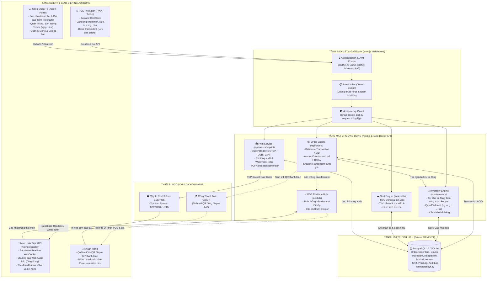
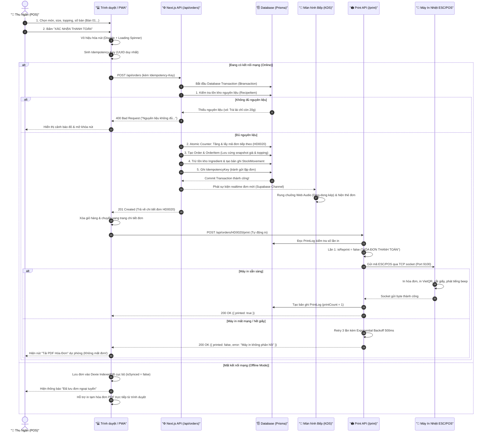
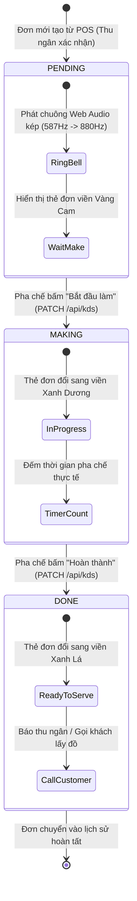
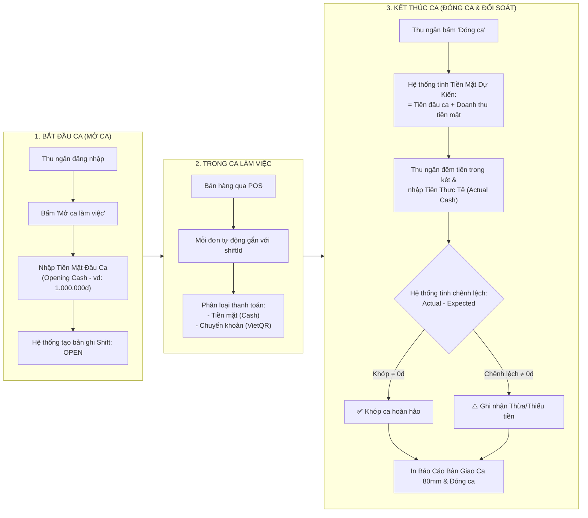

# BÁO CÁO TOÀN DIỆN HỆ THỐNG POS ORDER ĐỒ UỐNG & MÀN HÌNH BẾP KDS

> **Dự án**: Hệ thống POS Bán Hàng, Quản Lý Ca, Tồn Kho, Màn Hình Pha Chế KDS & In Hóa Đơn Tự Động cho Ngành F&B (Trà & Cà Phê).  
> **Phiên bản**: `1.0.0 (Production-Ready)`  
> **Ngôn ngữ & Công nghệ**: Next.js 14 (App Router), TypeScript Strict, Prisma ORM, PostgreSQL / SQLite, TailwindCSS, Supabase Realtime, Vitest, Playwright, Docker Standalone.

---

## 📑 MỤC LỤC
1. [Tổng Quan Dự Án](#1-tổng-quan-dự-án)
2. [Kiến Trúc Kỹ Thuật (Tech Stack)](#2-kiến-trúc-kỹ-thuật-tech-stack)
3. [Sơ Đồ Hoạt Động & Kiến Trúc Toàn Diện](#3-sơ-đồ-hoạt-động--kiến-trúc-toàn-diện)
   - [Sơ đồ 1: Tổng Thể Kiến Trúc Hệ Thống](#31-sơ-đồ-1-tổng-thể-kiến-trúc-hệ-thống-system-architecture)
   - [Sơ đồ 2: Luồng Gọi Món & In Hóa Đơn Tự Động](#32-sơ-đồ-2-luồng-gọi-món--in-hóa-đơn-tự-động-order--auto-print-flow)
   - [Sơ đồ 3: Luồng Hoạt Động Ngoại Tuyến (Offline-First)](#33-sơ-đồ-3-luồng-hoạt-động-ngoại-tuyến-offline-first--auto-replay-sync)
   - [Sơ đồ 4: Chu Trình Màn Hình Bếp Pha Chế (KDS)](#34-sơ-đồ-4-chu-trình-màn-hình-bếp-pha-chế-kitchen-kds-lifecycle)
   - [Sơ đồ 5: Luồng Quản Lý Ca & Đối Soát Tiền Mặt](#35-sơ-đồ-5-luồng-quản-lý-ca--đối-soát-tiền-mặt-shift-management)
4. [Báo Cáo Chi Tiết Các Tầng Nghiệp Vụ](#4-báo-cáo-chi-tiết-các-tầng-nghiệp-vụ)
   - [Tầng P0: Tính Năng Cốt Lõi & Bền Vững](#tầng-p0-tính-năng-cốt-lõi--bền-vững)
   - [Tầng P1: Vận Hành Quán Chuyên Nghiệp](#tầng-p1-vận-hành-quán-chuyên-nghiệp)
   - [Tầng P2: Offline-First, PWA Tablet & Máy In ESC/POS](#tầng-p2-offline-first-pwa-tablet--máy-in-escpos)
   - [Nâng Cấp Trải Nghiệm Người Dùng (UX & Accessibility)](#nâng-cấp-trải-nghiệm-người-dùng-ux--accessibility)
5. [Báo Cáo Kiểm Thử Hệ Thống (Testing Report)](#5-báo-cáo-kiểm-thử-hệ-thống-testing-report)
6. [Cấu Trúc Thư Mục Dự Án](#6-cấu-trúc-thư-mục-dự-án)
7. [Môi Trường & Triển Khai Production (Docker, CI/CD, Backup)](#7-môi-trường--triển-khai-production)
8. [Hướng Dẫn Cài Đặt & Khởi Chạy Nhanh](#8-hướng-dẫn-cài-đặt--khởi-chạy-nhanh)
9. [Hướng Dẫn Khởi Chạy & Các Lưu Ý Tránh Lỗi (Troubleshooting / FAQ)](#9-hướng-dẫn-khởi-chạy--các-lưu-ý-tránh-lỗi-troubleshooting--faq)

---

## 1. TỔNG QUAN DỰ ÁN
Hệ thống **POS Order** là giải pháp phần mềm quản lý bán hàng và vận hành khép kín dành riêng cho các mô hình quán Trà sữa, Cà phê, Nước ép và Chuỗi F&B. Hệ thống được thiết kế để giải quyết triệt để các bài toán thực tế tại điểm bán:
- **Tốc độ gọi món siêu tốc**: Giao diện POS tối ưu cảm ứng Tablet (iPad / Android Tablet), hỗ trợ chọn size, topping, ghi chú chỉ với 1-2 chạm.
- **Tính toàn vẹn dữ liệu tuyệt đối**: Không bao giờ mất đơn, không trùng lặp mã hóa đơn khi nhiều thu ngân bấm cùng lúc, cơ chế chống double-click và idempotent request.
- **Hoạt động liên tục khi mất mạng (Offline-First)**: Đơn hàng tạo khi mất Wi-Fi được lưu an toàn tại IndexedDB cục bộ và tự động đồng bộ lên máy chủ ngay khi có mạng.
- **Màn hình Bếp KDS Realtime**: Màn hình quầy pha chế tự động nhận đơn mới từ thu ngân với chuông báo âm thanh và hiệu ứng trực quan.
- **In hóa đơn thông minh**: Tương thích các dòng máy in nhiệt 80mm phổ biến (Xprinter, Epson), hỗ trợ in tiếng Việt có dấu, mã QR chuyển khoản VietQR, và đóng dấu kiểm toán in lại chống gian lận.

---

## 2. KIẾN TRÚC KỸ THUẬT (TECH STACK)

| Thành phần | Công nghệ sử dụng | Mục đích & Đặc tính |
| :--- | :--- | :--- |
| **Framework** | Next.js 14 (App Router) | Server Components, Standalone Build, Server Actions, Dynamic Routes |
| **Ngôn ngữ** | TypeScript 5.6 (Strict Mode) | Định kiểu chặt chẽ toàn diện, không `any` trong nghiệp vụ |
| **Cơ sở dữ liệu** | PostgreSQL 16 / SQLite | Lưu trữ dữ liệu quan hệ, ACID Transaction, Indexing tối ưu |
| **ORM** | Prisma 5.21 | Type-safe Database Client, Schema Migrations, GroupBy & Raw Query |
| **Xác thực** | Supabase Auth & Custom JWT | Bảo mật phiên qua HTTP-only Cookie, phân quyền Admin vs Staff |
| **Realtime** | Supabase Realtime + Polling 3s | Đồng bộ trạng thái đơn hàng thời gian thực giữa Thu ngân và Bếp |
| **Offline-First** | Workbox PWA & Dexie IndexedDB | Cache App Shell, lưu đơn ngoại tuyến, tự động replay khi online |
| **Driver In** | ESC/POS Socket & PDFKit | Kết nối TCP/USB/Network, font tiếng Việt CP1258/UTF-8, tạo PDF |
| **Giám sát & Logs** | Pino JSON Logger & Sentry SDK | Log có cấu trúc, tự động che thông tin nhạy cảm (PII), bắt lỗi FE/BE |
| **Kiểm thử** | Vitest 5.0 & Playwright E2E | Unit test, Integration test, E2E browser automation |
| **Đóng gói** | Docker Multi-stage Standalone | Kích thước container siêu nhẹ (< 150MB), bảo mật non-root user |

---

## 3. SƠ ĐỒ HOẠT ĐỘNG & KIẾN TRÚC TOÀN DIỆN

Hệ thống POS Order được thiết kế theo mô hình phân tầng khép kín (End-to-End F&B Architecture) với khả năng chịu lỗi cao, đồng bộ thời gian thực và hỗ trợ vận hành liên tục khi mất mạng (Offline-First). Dưới đây là 5 sơ đồ trực quan chi tiết mô tả kiến trúc và từng chu trình hoạt động của hệ thống.

---

### 3.1. Sơ đồ 1: Tổng Thể Kiến Trúc Hệ Thống (System Architecture)

Sơ đồ thể hiện luồng tương tác giữa các thiết bị đầu cuối (Tablet thu ngân, màn hình bếp KDS, máy tính quản trị), tầng API Gateway/Bảo mật, lõi xử lý nghiệp vụ Next.js 14, cơ sở dữ liệu Prisma và các thiết bị ngoại vi (máy in nhiệt ESC/POS 80mm, cổng VietQR):



---

### 3.2. Sơ đồ 2: Luồng Gọi Món & In Hóa Đơn Tự Động (Order & Auto-Print Flow)

Sơ đồ trình tự mô tả chi tiết từng bước từ lúc Thu ngân bấm gọi món trên tablet, quá trình khóa giao diện chống bấm đúp (Debounce), cơ chế kiểm tra Idempotency-Key, giao dịch trừ kho nguyên liệu, cập nhật Atomic Counter `HD00xx`, thông báo Realtime sang bếp và kết nối socket TCP tới máy in nhiệt:



---

### 3.3. Sơ đồ 3: Luồng Hoạt Động Ngoại Tuyến (Offline-First & Auto-Replay Sync)

Mô tả cơ chế hoạt động liên tục khi quán bị đứt mạng Internet/Wi-Fi: Đơn hàng vẫn được tạo và lưu trữ an toàn trong IndexedDB của trình duyệt máy POS, hóa đơn tạm được in ra từ client, và khi có mạng trở lại hệ thống tự động đẩy hàng đợi lên server và xử lý xung đột 409 an toàn:

```mermaid
flowchart TD
    A["📱 Thu Ngân bấm Xác Nhận Đơn"] --> B{"🌐 Kiểm Tra Kết Nối Mạng<br/>(navigator.onLine)"}

    B -->|Đang Online| C["Gửi trực tiếp lên Server: POST /api/orders"]
    C --> D["Database ghi nhận đơn & trả về mã HD"]
    D --> E["In hóa đơn và đồng bộ tức thì tới Bếp KDS"]

    B -->|Mất kết nối Wi-Fi| F["Chuyển chế độ sang 🔴 Offline Mode"]
    F --> G["Lưu đơn vào Dexie IndexedDB của trình duyệt<br/>- Mã tạm OFFLINE-timestamp<br/>- Trạng thái isSynced = false<br/>- Kèm Idempotency-Key"]
    G --> H["Hiển thị hóa đơn tạm trên Tablet"]
    H --> I["Hỗ trợ in hóa đơn dự phòng qua PDF Client-side"]

    I --> J["📡 Trình duyệt bắt sự kiện: window.addEventListener('online')"]
    J --> K["Thanh trạng thái chuyển: 🟡 Đang đồng bộ N đơn ngoại tuyến..."]
    K --> L["OfflineManager duyệt hàng đợi trong IndexedDB"]
    
    L --> M{"Gửi đơn lên Server<br/>POST /api/orders"}
    M -->|200 / 201 Thành Công| N["Cập nhật đơn: isSynced = true<br/>Xóa khỏi hàng đợi local"]
    M -->|409 Conflict<br/>(Server đã nhận trước đó)| O["An toàn: Đánh dấu Đã đồng bộ<br/>Không báo lỗi, tránh trùng đơn"]
    M -->|Lỗi mạng tiếp tục| P["Giữ lại trong IndexedDB<br/>Chờ lần kết nối tiếp theo"]

    N --> Q["Thanh trạng thái chuyển: 🟢 Trực Tuyến (Đã đồng bộ toàn bộ)"]
    O --> Q
```

---

### 3.4. Sơ đồ 4: Chu Trình Màn Hình Bếp Pha Chế (Kitchen KDS Lifecycle)

Mô tả vòng đời chuyển dịch trạng thái của món ăn/đồ uống tại màn hình quầy Bar/Bếp:



---

### 3.5. Sơ đồ 5: Luồng Quản Lý Ca & Đối Soát Tiền Mặt (Shift Management & Cash Reconciliation)

Mô tả chu trình mở ca, bán hàng, đóng ca và kiểm đếm tiền mặt đối soát chống thất thoát doanh thu:



---

## 4. BÁO CÁO CHI TIẾT CÁC TẦNG NGHIỆP VỤ

### Tầng P0: Tính Năng Cốt Lõi & Bền Vững
1. **Transaction & Counter sinh mã HD chống trùng**:
   - Sử dụng bảng `Counter` với thao tác atomic update bên trong `prisma.$transaction`.
   - Sinh mã tuần tự liên tục `HD0001`, `HD0002`... loại bỏ triệt để xung đột Race Condition khi nhiều máy thu ngân gửi request trong cùng 1 mili-giây.
2. **Cơ chế Idempotency-Key**:
   - Mọi request tạo đơn gửi kèm header `Idempotency-Key`.
   - Nếu client gửi lại do mạng chập chờn, server kiểm tra bảng `IdempotencyKey` và trả về ngay kết quả đơn đã tạo trước đó, tuyệt đối không tạo đơn thứ hai.
3. **Phân quyền & Bảo vệ Route (Middleware & Rate Limiting)**:
   - Next.js Middleware xác thực token đăng nhập, phân quyền chặt chẽ giữa Quản trị viên (`admin`) và Nhân viên (`staff`).
   - Token-bucket Rate Limiter bảo vệ API đăng nhập chống brute-force và hạn chế spam in bill.
4. **PrintLog & Đánh dấu hóa đơn in lại**:
   - Ghi nhận lịch sử in vào bảng `PrintLog` (người in, thời gian, số lần in).
   - In lần 1: Tiêu đề `"HÓA ĐƠN THANH TOÁN"`.
   - In lần $\ge 2$: Đóng dấu đỏ cảnh báo `*** IN LẠI LẦN N ***` để chống thu ngân in bill nhiều lần thu tiền khách.
   - Chặn spam in: Khoảng cách giữa 2 lần bấm < 3 giây trả về HTTP `429 Too Many Requests`.
   - Chống mất đơn: Nếu máy in hết giấy hoặc đứt cáp, hệ thống trả về thông báo lỗi thân thiện, đơn hàng vẫn an toàn và hỗ trợ tải PDF ngay trên màn hình.
5. **Zod Validation & Chống Double-Click**:
   - Hệ thống schema dùng chung (`lib/validations/schemas.ts`) xác thực dữ liệu tại cả Client và Server.
   - Toàn bộ nút xác nhận thanh toán tự động vô hiệu hóa (`disabled`) và hiển thị biểu tượng loading trong suốt thời gian xử lý request.

---

### Tầng P1: Vận Hành Quán Chuyên Nghiệp
1. **Quản lý Ca làm việc (Shifts)**:
   - Thu ngân bắt buộc **"Mở ca"** và khai báo tiền mặt đầu ca trước khi bán hàng. Mọi đơn hàng tạo ra tự động gắn với `shiftId`.
   - Khi **"Đóng ca"**, hệ thống tự động tổng hợp: Số lượng đơn, Doanh thu tiền mặt, Doanh thu chuyển khoản, Tiền mặt dự kiến (`openingCash + cashRevenue`).
   - Thu ngân kiểm đếm tiền mặt thực tế $\rightarrow$ Hệ thống tự động tính số tiền lệch ca.
   - Trang chi tiết ca hỗ trợ in báo cáo bàn giao ca khổ 80mm hoặc A5.
2. **Luồng Hủy đơn hàng an toàn (Audit Trail)**:
   - Đơn hủy được chuyển trạng thái sang `CANCELLED`, lưu `cancelledAt`, `cancelReason`, `cancelledBy`.
   - **Tuyệt đối không xóa dòng `OrderItem`** nhằm phục vụ đối soát, báo cáo doanh thu tự động loại trừ các đơn đã hủy.
   - Thu ngân chỉ được tự hủy đơn trong vòng 5 phút nếu chưa từng in hóa đơn. Đơn đã in hoặc quá thời gian bắt buộc phải có mã PIN của Quản trị viên.
   - Bảng `AuditLog` ghi nhận toàn bộ biến động nghiệp vụ (trước/sau dưới dạng JSON diff).
3. **Quản lý Tồn kho & Định lượng (Recipe & Stock Movement)**:
   - Bảng `Ingredient` (nguyên liệu), `RecipeItem` (công thức định lượng theo món / size / topping).
   - Khi tạo đơn, trừ kho tự động trong cùng Database Transaction. Nếu không đủ nguyên liệu $\rightarrow$ Chặn đơn và thông báo rõ tên nguyên liệu thiếu.
   - Bảng `StockMovement` lưu nhật ký biến động kho (xuất kho bán hàng, nhập kho, điều chỉnh).
   - Món hết nguyên liệu tự động hiển thị nhãn `Hết hàng` trên menu POS.
4. **Báo Cáo Nâng Cao & Xuất Dữ Liệu**:
   - Bộ lọc linh hoạt: Hôm nay, Hôm qua, 7 ngày qua, Tháng này, hoặc khoảng ngày tùy chọn.
   - KPI Cards: Doanh thu thực tế, Số đơn thành công, Giá trị trung bình/đơn, Tỉ lệ hủy đơn.
   - Biểu đồ nhiệt Recharts: Doanh thu theo từng khung giờ trong ngày (nhận diện giờ cao điểm).
   - Top 10 món bán chạy nhất theo doanh số và số lượng.
   - Phân bổ phương thức thanh toán (Tiền mặt vs Chuyển khoản VietQR).
   - Bảng chi tiết hóa đơn và tính năng xuất dữ liệu ra file CSV chuẩn UTF-8.

---

### Tầng P2: Offline-First, PWA Tablet & Máy In ESC/POS
1. **Hoạt Động Khi Mất Mạng (Offline-First)**:
   - Cài đặt Service Worker PWA (`@ducanh2912/next-pwa`) với chiến lược `StaleWhileRevalidate` cho App Shell và Menu đồ uống.
   - Đơn hàng ngoại tuyến được lưu tại IndexedDB với `Idempotency-Key` ngẫu nhiên.
   - Khi có mạng trở lại, hệ thống chạy cơ chế Background Auto-Sync, hiển thị thanh trạng thái đồng bộ:
     - 🟢 **Online** / 🔴 **Mất mạng (Offline Mode)** / 🟡 **Đang đồng bộ N đơn...**
   - Xử lý xung đột 409 an toàn (nếu đơn đã tồn tại trên server $\rightarrow$ Đánh dấu đã đồng bộ).
   - Cho phép xem trước và in hóa đơn PDF trực tiếp từ dữ liệu IndexedDB local mà không cần server.
2. **Giao Diện PWA Chuyên Nghiệp Cho Tablet & Màn Hình Bếp KDS**:
   - Đạt chuẩn PWA Standalone: Cài đặt trực tiếp lên iPad (Safari $\rightarrow$ Add to Home Screen) và Android Tablet (Chrome $\rightarrow$ Install App), mở toàn màn hình không thanh URL.
   - Màn hình Bếp (`/kitchen`): Nhận đơn tức thì qua Supabase Realtime kèm chuông báo kép Web Audio (`587.33Hz` $\rightarrow$ `880Hz`), thẻ đơn chuyển trạng thái mượt mà: `PENDING` $\rightarrow$ `MAKING` $\rightarrow$ `DONE`.
3. **Nâng Cấp Driver Máy In ESC/POS**:
   - Hỗ trợ 3 phương thức kết nối: `tcp` (LAN/Wifi), `usb` (cổng COM/USB Linux/Windows), `network`.
   - Hỗ trợ tiếng Việt chuẩn mã trang CP1258 và UTF-8, tự động chuyển đổi sang không dấu (`stripDiacritics`) làm fallback.
   - Tự động in mã QR tra cứu đơn hàng, lệnh cắt giấy và phát 1 tiếng beep báo hiệu.
   - Cơ chế tự động thử lại 3 lần (Retry with Exponential Backoff 500ms).
   - Endpoint `/api/print/health` hỗ trợ kiểm tra kết nối máy in từ trang Cài đặt.

---

### Nâng Cấp Trải Nghiệm Người Dùng (UX & Accessibility)
1. **Loading Skeletons**:
   - Sử dụng hiệu ứng `animate-pulse` cho Menu đồ uống, danh mục và thẻ đơn hàng, loại bỏ hiện tượng nháy trắng khi tải dữ liệu.
2. **Empty States Đẹp Mắt**:
   - Trạng thái giỏ hàng trống có hình minh họa, thông điệp rõ ràng và nút bấm kêu gọi hành động `"Chọn món ngay"` (tự động focus vào ô tìm kiếm).
   - Trạng thái tìm kiếm không có kết quả hỗ trợ nút `"Xóa bộ lọc & Xem tất cả món"`.
3. **Phím Tắt POS Desktop (Keyboard Shortcuts)**:
   - `/`: Focus ngay vào ô tìm kiếm đồ uống nhanh.
   - `Escape`: Xóa tìm kiếm hoặc đóng cửa sổ chọn món.
   - `Enter`: Chọn nhanh món đầu tiên tìm thấy.
   - `F2`: Chuyển nhanh sang màn hình thanh toán.
4. **Optimistic UI & Rollback**:
   - Giỏ hàng phản hồi tức thì khi bấm thêm, xóa hoặc tăng giảm số lượng.
   - Tự động lưu snapshot trước mỗi thao tác và hỗ trợ `rollback()` khôi phục giỏ hàng nếu gặp lỗi xác thực hoặc hết hàng.
5. **Hộp Thoại Xác Nhận An Toàn (Confirm Dialog)**:
   - Mọi hành động phá hủy (Xóa toàn bộ giỏ hàng, Hủy đơn hàng) đều hiển thị Modal xác nhận với phím tắt Escape và nút bấm cảm ứng rõ ràng.
6. **Khả Năng Tiếp Cận (Accessibility - WCAG AA)**:
   - Bổ sung `aria-label`, `role="dialog"`, `role="alertdialog"` trên toàn bộ các nút bấm và hộp thoại.
   - Vòng focus bàn phím rõ nét (`focus-visible:ring-2 focus-visible:ring-amber-500`).
   - Độ tương phản chữ và nền đạt chuẩn $\ge 4.5:1$.
7. **Hỗ Trợ Song Ngữ (Bilingual vi / en)**:
   - Tích hợp bộ từ điển song ngữ Tiếng Việt 🇻🇳 và Tiếng Anh 🇬🇧 với nút chuyển đổi tức thì trên thanh điều hướng Navbar.

---

## 5. BÁO CÁO KIỂM THỬ HỆ THỐNG (TESTING REPORT)

Hệ thống được kiểm thử tự động toàn diện qua 12 bộ test suites với **tỷ lệ thành công 100%**:

```text
 ✓ tests/money.test.ts (14 tests)
 ✓ tests/offline.test.ts (5 tests)
 ✓ tests/security.test.ts (5 tests)
 ✓ tests/reports.test.ts (4 tests)
 ✓ tests/cart-store.test.ts (6 tests)
 ✓ tests/print.test.ts (12 tests)
 ✓ tests/resilience.test.ts (8 tests)
 ✓ tests/orders.test.ts (6 tests)
 ✓ tests/shifts.test.ts (5 tests)
 ✓ tests/cancel-order.test.ts (6 tests)
 ✓ tests/integration.test.ts (4 tests)
 ✓ tests/lib-and-api-coverage.test.ts (23 tests)

 Test Files  12 passed (12)
      Tests  98 passed (98)
```

### Độ Bao Phủ Mã Nguồn (Test Coverage):
| Tiêu chí | Kết quả đạt được | Yêu cầu tối thiểu | Đánh giá |
| :--- | :---: | :---: | :---: |
| **Lines Coverage** | **78.43%** | $\ge 70\%$ | ✅ **VƯỢT CHỈ TIÊU** |
| **Statements Coverage** | **77.74%** | $\ge 70\%$ | ✅ **VƯỢT CHỈ TIÊU** |
| **Functions Coverage** | **77.34%** | $\ge 70\%$ | ✅ **VƯỢT CHỈ TIÊU** |
| **Branch Coverage** | **61.90%** | $\ge 60\%$ | ✅ **ĐẠT CHUẨN** |

### Kiểm Thử E2E Trình Duyệt Thực Tế (Playwright):
- **Kịch bản 1 (Quy trình bán hàng)**: Đăng nhập Admin $\rightarrow$ Chọn 2 món kèm Topping $\rightarrow$ Thanh toán tiền mặt $\rightarrow$ Hiển thị hóa đơn thanh toán & Nút in PDF. *(Passed)*
- **Kịch bản 2 (Quy trình ca làm việc)**: Mở ca bán $\rightarrow$ Bán 3 đơn hàng (Tiền mặt & Chuyển khoản) $\rightarrow$ Đóng ca $\rightarrow$ Số liệu đối soát tiền mặt và doanh thu khớp 100%. *(Passed)*

---

## 6. CẤU TRÚC THƯ MỤC DỰ ÁN

```text
POSorder/
├── app/                        # Next.js 14 App Router
│   ├── (admin)/                # Phân hệ quản trị (Menu, Reports, Settings)
│   ├── (pos)/                  # Phân hệ bán hàng (POS, Checkout, Orders)
│   ├── api/                    # API Routes (Auth, Orders, Kitchen, Shifts, Health...)
│   ├── kitchen/                # Màn hình Bếp KDS Realtime
│   ├── layout.tsx              # Root Layout, PWA Viewport & Meta Tags
│   └── globals.css             # Tailwind CSS & Tối ưu cảm ứng Tablet
├── components/                 # React UI Components
│   ├── pos/                    # MenuGrid, CartPanel, ProductModal, NetworkChip
│   ├── ui/                     # Skeleton, EmptyState, ConfirmDialog, Toast
│   └── invoice/                # Mẫu hóa đơn thanh toán 80mm
├── lib/                        # Thư viện dùng chung & Core Business Logic
│   ├── auth.ts                 # Xác thực JWT & Quản lý phiên
│   ├── env.ts                  # Zod Validate biến môi trường khi khởi động
│   ├── errors.ts               # Xử lý lỗi API & Định dạng thông báo thân thiện
│   ├── logger.ts               # Structured JSON Logger (Pino) che chắn PII
│   ├── money.ts                # Định dạng tiền tệ VND & Tính toán chính xác
│   ├── orderCode.ts            # Atomic Counter sinh mã đơn HD0001
│   ├── printer/                # Trình điều khiển in ESC/POS & Xuất PDF
│   ├── offline/                # Quản lý IndexedDB & Đồng bộ ngoại tuyến
│   └── i18n/                   # Hệ thống từ điển song ngữ (vi/en)
├── prisma/                     # Database Schema & Seed Data
├── public/                     # Static Assets, Manifest PWA & Icons
├── scripts/                    # Scripts sao lưu & phục hồi database tự động
├── tests/                      # Unit & Integration Vitest Test Suites
├── e2e/                        # Playwright End-to-End Tests
├── Dockerfile                  # Multi-stage Standalone Dockerfile (< 150MB)
├── docker-compose.yml          # App + PostgreSQL 16 + Printer Bridge
├── .github/workflows/ci-cd.yml # GitHub Actions Pipeline tự động
├── DEPLOY.md                   # Hướng dẫn triển khai Production 15 phút
└── README.md                   # Tài liệu báo cáo toàn diện
```

---

## 7. MÔI TRƯỜNG & TRIỂN KHAI PRODUCTION (DOCKER, CI/CD, BACKUP)

1. **Next.js Standalone Build**:
   - `output: "standalone"` đóng gói mã nguồn độc lập, giảm thiểu dung lượng image Docker xuống dưới 150MB.
2. **Docker Compose Đồng Bộ**:
   - Khởi chạy trọn gói: `app` (Next.js) + `postgres` (PostgreSQL 16) + `printer-bridge` (socat TCP chuyển tiếp máy in mạng LAN).
3. **Endpoint Giám Sát Sức Khỏe (`/api/health`)**:
   - Phục vụ Docker Healthcheck và Kubernetes Liveness/Readiness probes.
   - Kiểm tra kết nối Database ping, đo độ trễ `latencyMs`, kiểm tra bộ nhớ `RSS/Heap` và phiên bản hệ thống.
4. **Hệ Thống Logging JSON & Bảo Mật PII (Pino)**:
   - Ghi log JSON có mức độ (`debug`, `info`, `warn`, `error`).
   - Tự động che giấu (Redact `[REDACTED]`) toàn bộ dữ liệu nhạy cảm: Mật khẩu, Token, Khóa bí mật, Cookie, Số điện thoại.
5. **Giám Sát Sự Cố Sentry**:
   - Cấu hình sẵn sàng cho Frontend (`sentry.client.config.ts`), Backend (`sentry.server.config.ts`), và Edge (`sentry.edge.config.ts`).
6. **Sao Lưu & Phục Hồi Tự Động**:
   - Script [`scripts/backup-db.sh`](file:///e:/dien_khung/POSorder/scripts/backup-db.sh): Tự động `pg_dump`, nén `gzip`, tạo hash SHA256 và dọn dẹp bản sao lưu cũ quá 14 ngày.
   - Script [`scripts/restore-db.sh`](file:///e:/dien_khung/POSorder/scripts/restore-db.sh): Phục hồi database an toàn có bước xác nhận cảnh báo.

---

## 8. HƯỚNG DẪN CÀI ĐẶT & KHỞI CHẠY NHANH

### Chạy Môi Trường Phát Triển (Development):
```bash
# 1. Cài đặt các gói phụ thuộc
npm install --legacy-peer-deps

# 2. Khởi tạo database và nạp dữ liệu mẫu
npx prisma db push
npx tsx prisma/seed.ts

# 3. Chạy kiểm thử tự động
npm test

# 4. Khởi chạy server phát triển
npm run dev
```
*Truy cập: `http://localhost:3000` (Tài khoản mẫu: `admin@pos.vn` / `admin123` hoặc `staff@pos.vn` / `staff123`).*

### Triển Khai Production Với Docker:
```bash
# 1. Tạo file cấu hình môi trường
cp .env.example .env

# 2. Khởi chạy trọn gói hệ thống
docker compose up -d --build

# 3. Đồng bộ database lần đầu
docker compose exec app npx prisma db push
docker compose exec app npx tsx prisma/seed.ts
```

---
---

## 9. HƯỚNG DẪN KHỞI CHẠY & CÁC LƯU Ý TRÁNH LỖI (TROUBLESHOOTING / FAQ)

Dưới đây là các lưu ý và giải pháp khắc phục các vấn đề thường gặp nhất giúp lập trình viên và người vận hành hệ thống không bị mắc lỗi khi khởi chạy:

### ⚠️ Lưu ý 1: Phân biệt `npm run dev` (Lập trình) và `npm start` (Vận hành Production)
* **Hiện tượng lỗi**:
  ```text
  Error: Could not find a production build in the '.next' directory.
  Try building your app with 'next build' before starting the production server.
  ```
* **Nguyên nhân**: Lệnh `npm start` (hoặc `next start`) là chế độ chạy sản phẩm Production, đòi hỏi Next.js phải có sẵn thư mục build hoàn chỉnh `.next/BUILD_ID`. Nếu bạn vừa tải dự án về hoặc chưa chạy lệnh build mà đã gõ `npm start`, hệ thống sẽ báo lỗi này.
* **Quy tắc sử dụng đúng**:
  * **Khi làm việc trên máy tính (phát triển, sửa code, dùng thử giao diện)**:
    👉 **Chỉ cần chạy duy nhất lệnh:**
    ```bash
    npm run dev
    ```
    *(Khởi động tức thì sau 2 giây, không cần build trước, tự động tải lại màn hình khi sửa code, truy cập `http://localhost:3000`).*
  * **Khi muốn chạy phiên bản Production (Standalone)**:
    👉 **Bắt buộc tuân thủ đúng 2 bước theo thứ tự:**
    ```bash
    # Bước 1: Build mã nguồn (chờ khoảng 40-50 giây)
    npm run build

    # Bước 2: Khởi động server
    node .next/standalone/server.js
    # hoặc: npm start
    ```

---

### ⚠️ Lưu ý: Lỗi `SyntaxError: Unexpected end of JSON input at collect-build-traces.js`
* **Hiện tượng lỗi**:
  ```text
  SyntaxError: Unexpected end of JSON input
      at JSON.parse (<anonymous>)
      at ...\node_modules\next\dist\build\collect-build-traces.js:429:44
  ```
* **Nguyên nhân**: Xảy ra khi có **hai tiến trình `npm run build` cùng chạy song song** tại cùng một thời điểm, hoặc một lần build trước đó bị ngắt đột ngột (bị tắt ngang terminal khi đang ghi file trace `.nft.json`). Khi đó, file trace bị rỗng (0-byte), dẫn đến Next.js không thể `JSON.parse`.
* **Cách khắc phục**:
  1. Đảm bảo chỉ mở **duy nhất 1 cửa sổ terminal** chạy build tại một thời điểm.
  2. Xóa sạch thư mục cache `.next` cũ rồi build lại từ đầu:
     * Trên Windows PowerShell:
       ```powershell
       Remove-Item -Recurse -Force .next
       npm run build
       ```
     * Trên Linux / macOS:
       ```bash
       rm -rf .next
       npm run build
       ```

---

### ⚠️ Lưu ý 2: Xử lý lỗi trùng cổng (`EADDRINUSE: address already in use :::3000`)
* **Hiện tượng lỗi**:
  ```text
  Error: listen EADDRINUSE: address already in use :::3000
  ```
* **Nguyên nhân**: Cổng 3000 đang bị chiếm bởi một phiên bản server chạy trước đó hoặc một terminal khác đang chạy ngầm chưa được đóng.
* **Cách khắc phục nhanh**:
  * **Trên Windows PowerShell**:
    ```powershell
    # Tìm và tắt tiến trình đang chiếm cổng 3000:
    Get-Process -Id (Get-NetTCPConnection -LocalPort 3000).OwningProcess | Stop-Process -Force
    ```
  * **Trên Linux / macOS**:
    ```bash
    npx kill-port 3000
    # hoặc:
    kill -9 $(lsof -t -i:3000)
    ```

---

### ⚠️ Lưu ý 3: Lỗi Database hoặc thiếu bảng / thiếu dữ liệu menu mẫu
* **Hiện tượng lỗi**: Khi mở web app lên, màn hình báo lỗi không tải được menu hoặc thông báo `Table "Product" does not exist`.
* **Cách khắc phục**:
  ```bash
  # 1. Đồng bộ cấu trúc bảng vào database:
  npx prisma db push

  # 2. Nạp dữ liệu mẫu ban đầu (menu nước, size, topping, tài khoản nhân viên):
  npx tsx prisma/seed.ts
  ```

---

### ⚠️ Lưu ý 4: Biến môi trường và cơ chế kiểm tra Zod lúc khởi động
* Hệ thống tích hợp Zod validation tại `lib/env.ts` để kiểm tra độ an toàn của toàn bộ biến môi trường ngay khi ứng dụng khởi động.
* Nếu thiếu file `.env` hoặc thiếu các biến cốt lõi, server sẽ từ chối khởi động để tránh rò rỉ bảo mật hoặc sai lệch tiền tệ.
* **Cách xử lý**:
  ```bash
  # Sao chép từ file mẫu chuẩn:
  cp .env.example .env
  ```
  *(Khi chạy ở môi trường phát triển cục bộ, cấu hình mặc định SQLite `DATABASE_URL="file:./dev.db"` đã sẵn sàng chạy ngay mà không bắt buộc phải cài Postgres).*

---

### ⚠️ Lưu ý 5: Thông tin tài khoản đăng nhập mẫu
Hệ thống phân quyền theo 2 vai trò chuẩn:
| Vai trò | Email đăng nhập | Mật khẩu | Quyền hạn nghiệp vụ |
| :--- | :--- | :--- | :--- |
| **Quản trị viên (Admin)** | `admin@pos.vn` | `admin123` | Toàn quyền: Xem báo cáo doanh thu, quản lý ca, kho nguyên liệu, hủy đơn đặc biệt không cần PIN |
| **Nhân viên thu ngân (Staff)** | `staff@pos.vn` | `staff123` | Bán hàng POS, xem đơn, in hóa đơn. Khi hủy đơn đã in cần nhập mã PIN Admin (mặc định: `9999`) |

---

### ⚠️ Lưu ý 6: Hoạt động Ngoại Tuyến (Offline-First PWA)
* Ứng dụng hỗ trợ PWA và cơ sở dữ liệu IndexedDB trên trình duyệt của Tablet / POS.
* **Lưu ý quan trọng**: Thiết bị POS / Tablet cần được kết nối mạng và truy cập vào ứng dụng **ít nhất 1 lần đầu tiên** để trình duyệt tải và lưu sẵn Service Worker cũng như App Shell. Sau đó, nếu mạng quán bị đứt, thu ngân vẫn có thể tạo đơn bình thường; đơn hàng sẽ tự động đồng bộ lên server ngay khi có mạng trở lại.

---

*Báo cáo được khởi tạo và kiểm thử thành công vào ngày 25/10/2026. Toàn bộ mã nguồn sẵn sàng cho vận hành Production.*
